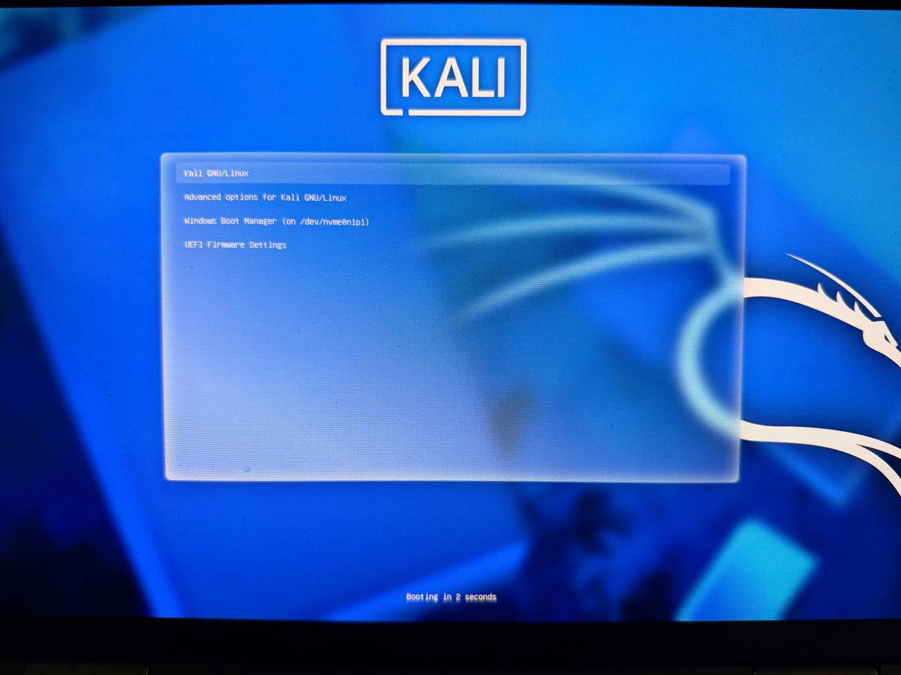
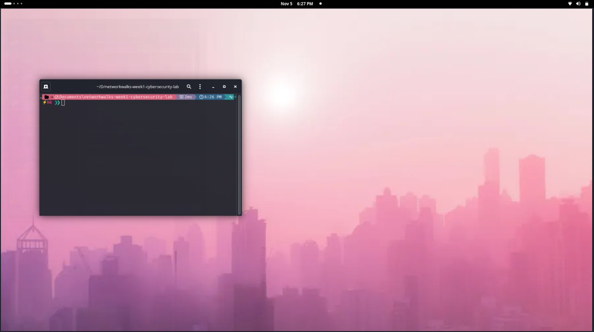
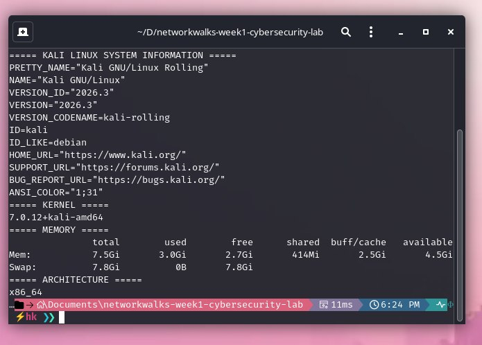
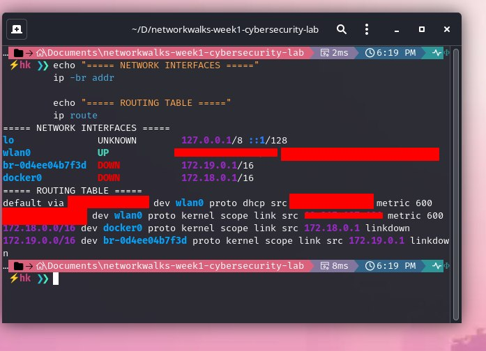
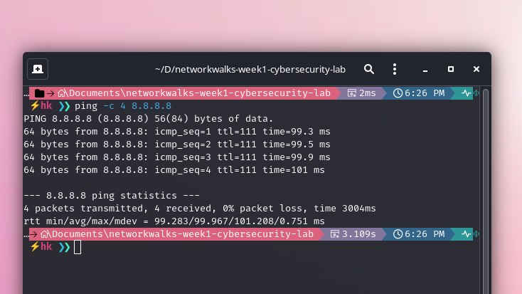

# Project Module 1 – Lab Setup

## Environment

- Host operating system: Windows
- Security operating system: Kali Linux
- Setup method: Dual boot

## Implementation

The original instructions described setting up Kali Linux using VirtualBox. I used my existing Windows and Kali Linux dual-boot configuration instead, which was approved as an alternative.

## Verification

- Confirmed that Kali Linux boots successfully.
- Checked operating system and kernel information.
- Inspected network interfaces and routing configuration.
- Tested internet connectivity.

## Screenshots

### Dual-Boot Configuration

### Kali Linux Desktop

### System Information

### Network Configuration

### Internet Connectivity

