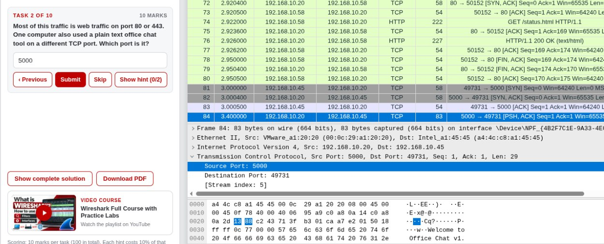
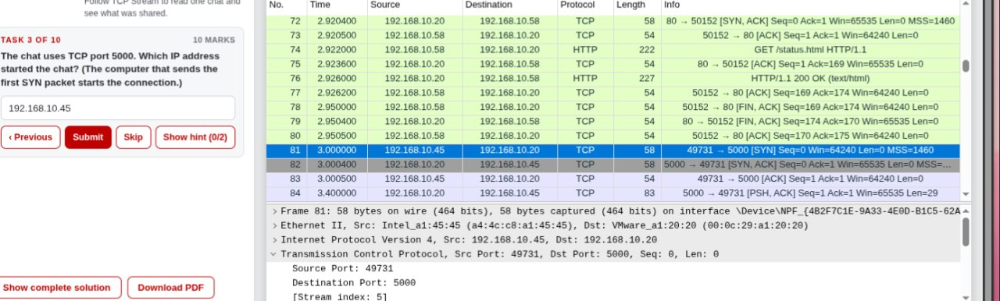
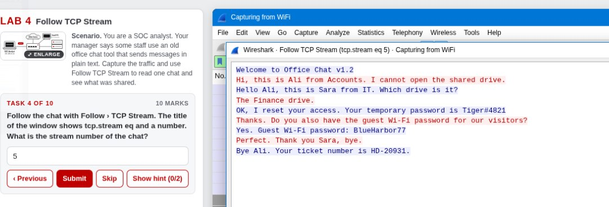

# Lab 4 – Follow TCP Stream

## Overview

This lab focused on analyzing TCP conversations in Wireshark and examining plain-text communication between computers on a network.

## Objectives

- Identify unusual TCP traffic.
- Find the port used by a plain-text office chat application.
- Identify the computer that initiated the chat connection.
- Follow TCP streams to inspect communication between endpoints.

## Tools Used

- Wireshark
- Networkwalks browser-based lab environment

## Tasks and Findings

| Task | Description | Finding |
|---|---|---|
| 1 | Identify the unusual TCP port used by the office chat | TCP port 5000 |
| 2 | Inspect the chat communication | Analyzed using Follow TCP Stream |
| 3 | Identify the computer that initiated the chat | Determined from the first TCP SYN packet |
| 4–10 | Continue TCP stream investigation | Completed in the lab environment |

## Wireshark Filters

**Filter traffic involving TCP port 5000:**

```text
tcp.port == 5000
```

**Find initial SYN packets:**

```text
tcp.port == 5000 && tcp.flags.syn == 1 && tcp.flags.ack == 0
```

## Analysis

The lab demonstrated how Wireshark's Follow TCP Stream feature can reconstruct TCP conversations and make readable application-layer communication easier to inspect.

The first SYN packet was used to identify which computer initiated the chat connection.

## Conclusion

This exercise demonstrated how TCP stream analysis can reveal plain-text communication and help identify the endpoints involved in a network conversation.

## Screenshots

### Task 2.1


### Task 2.2


### Task 2.3


### Task 2.4


### Final Result

