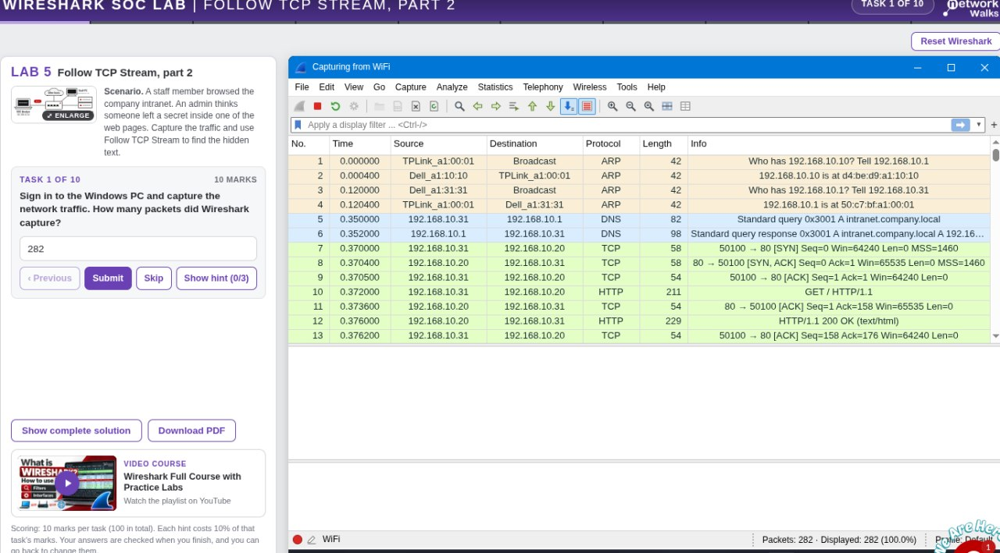
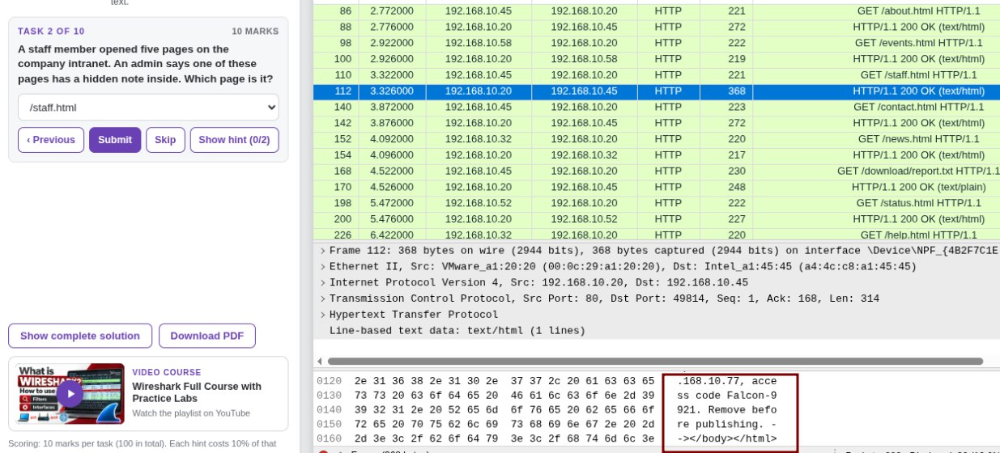
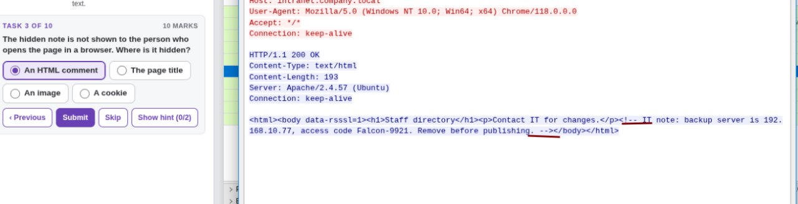
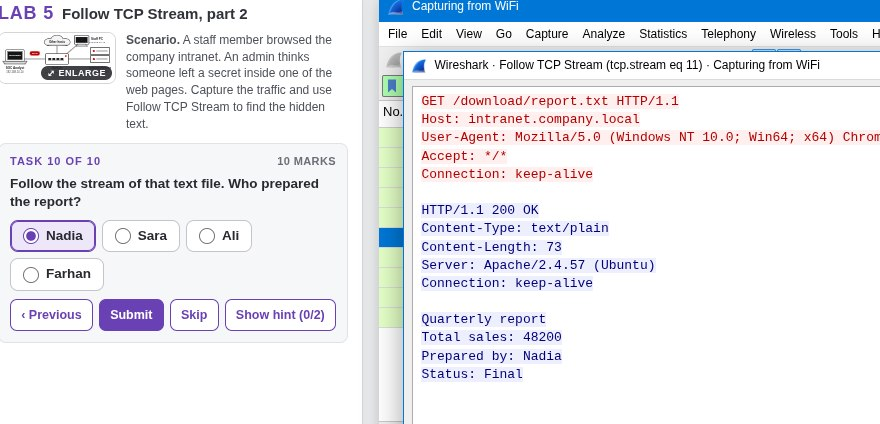

# Lab 5 – Follow TCP Stream: Hidden Data

## Overview

This lab focused on analyzing network traffic in Wireshark, following TCP streams, and examining captured communication to identify hidden information.

## Objectives

- Analyze HTTP traffic and TCP conversations.
- Follow TCP streams to reconstruct communication.
- Inspect page requests and server responses.
- Identify hidden information within captured traffic.

## Tools Used

- Wireshark
- Networkwalks browser-based lab environment

## Tasks and Findings

The lab involved examining captured traffic and inspecting HTTP requests and responses to locate hidden information.

Tasks 3–8 were answered using information obtained from the same packet analysis screenshot.

## Wireshark Filters

**Filter HTTP traffic:**

```text
http
```

**Filter HTTP traffic from a specific source IP:**

```text
http && ip.src == 192.168.10.20
```

**Display HTTP GET requests:**

```text
http.request.method == "GET"
```

## Analysis

HTTP requests were inspected to identify the pages accessed by the staff member. The corresponding server responses were examined to locate the page containing the hidden note.

Following the relevant TCP stream helped inspect the HTTP communication and its contents.

## Conclusion

This lab demonstrated how packet analysis and TCP stream inspection can reveal information contained in network communications, including data that may not be immediately visible when viewing a webpage.

## Screenshots

### Task 1


### Task 2


### Task 3–8 – Shared Packet Analysis


### Task 9


### Task 10


### Final Result

