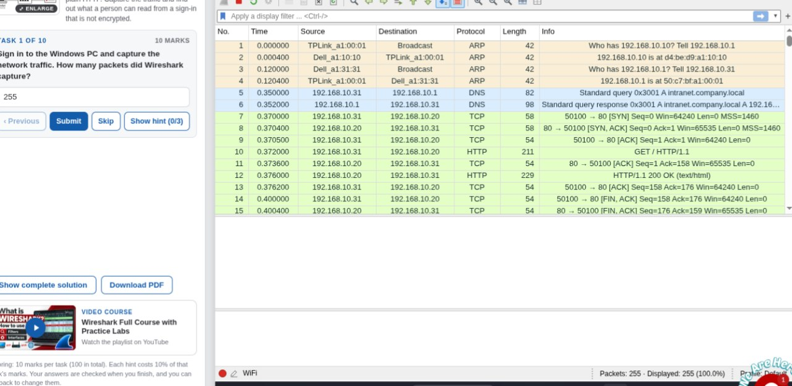
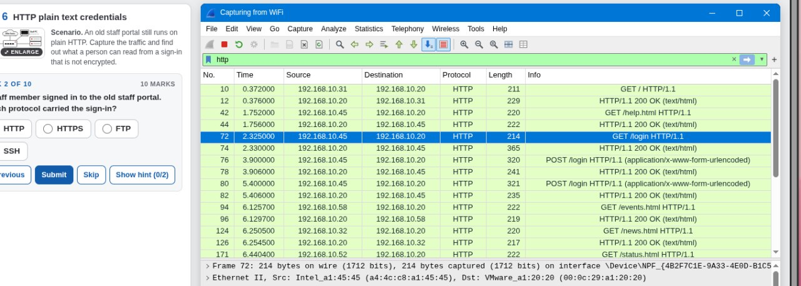
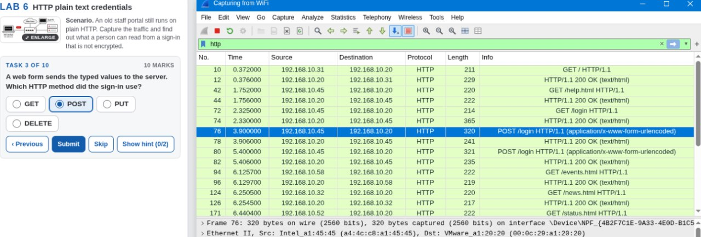
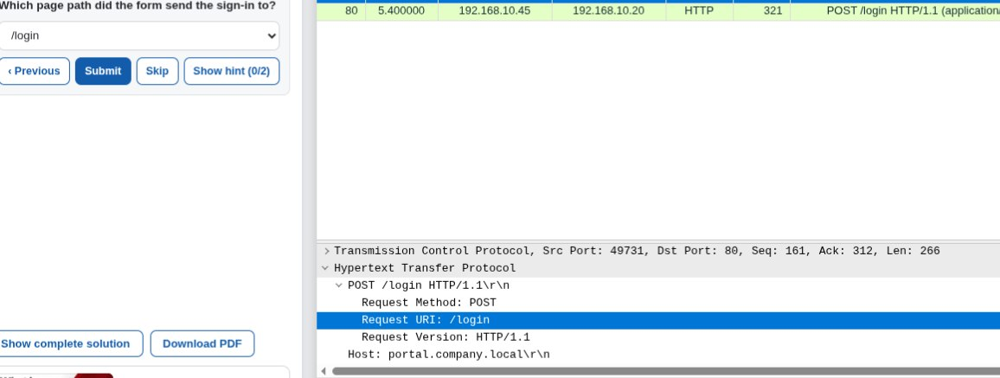
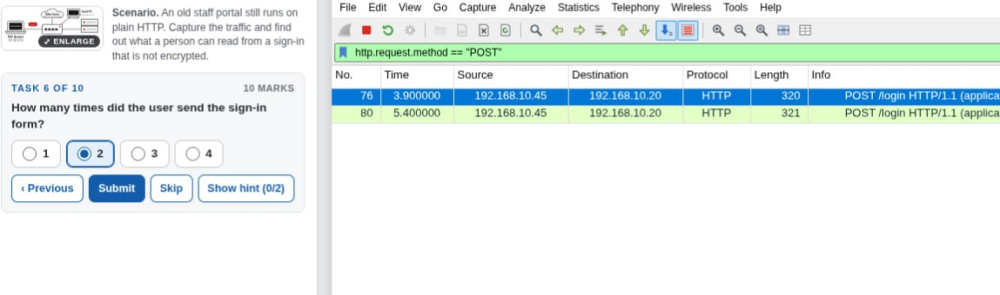
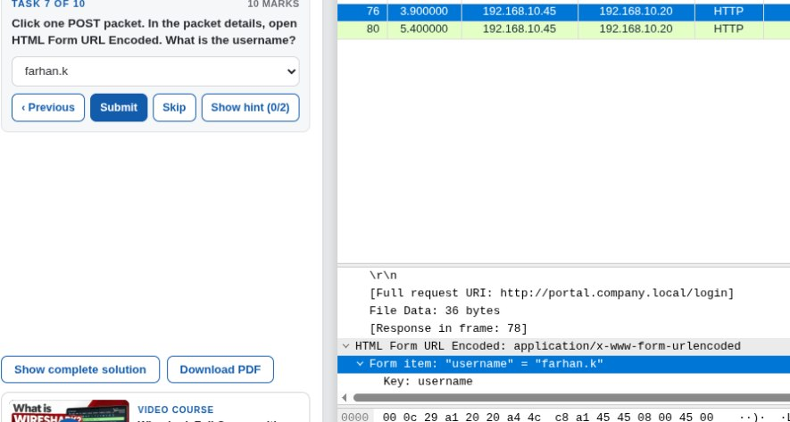
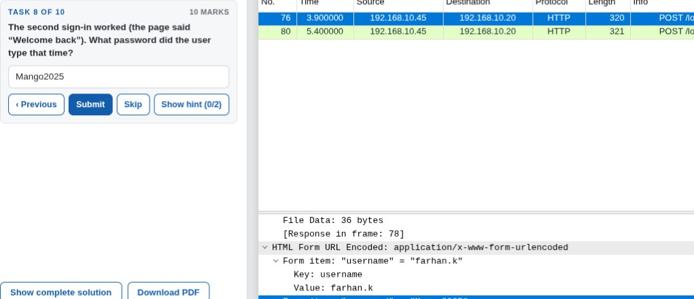
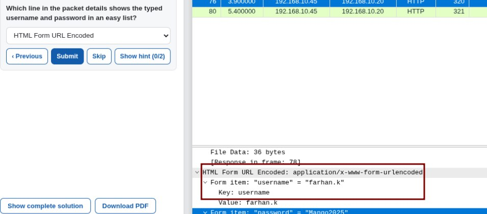

# Lab 6 – Identifying HTTP Plaintext Credentials

## Overview

This lab focused on analyzing HTTP traffic in Wireshark to identify login credentials transmitted without encryption.

## Objectives

- Inspect HTTP traffic.
- Identify login requests.
- Examine POST requests and their parameters.
- Identify the page path receiving the sign-in data.
- Understand the risks of transmitting passwords over unencrypted HTTP.

## Tools Used

- Wireshark
- Networkwalks browser-based lab environment

## Tasks and Findings

| Task | Description | Finding |
|---|---|---|
| Sign-in request | Identify the HTTP request method | POST |
| Form submission | Identify the page path receiving the sign-in data | `/login` |
| Task 10 | Recommend a way to protect passwords | Use HTTPS |

## Wireshark Filters

**Display HTTP POST requests:**

```text
http.request.method == "POST"
```

## Analysis

The HTTP traffic was inspected to identify the sign-in request. The POST request showed that the form submitted its data to the `/login` path.

Because the communication used unencrypted HTTP, credentials could be exposed to someone monitoring the network traffic.

## Security Recommendation

The company should use HTTPS to encrypt communication between users' browsers and the server. This helps prevent passwords from being read by people monitoring network traffic.

## Conclusion

This lab demonstrated the security risks of transmitting login credentials over unencrypted HTTP and the importance of using HTTPS to protect sensitive information.

## Screenshots

### Task 1


### Task 2


### Task 3


### Task 4


### Task 5


### Task 7


### Task 8


### Task 9


### Final Result

