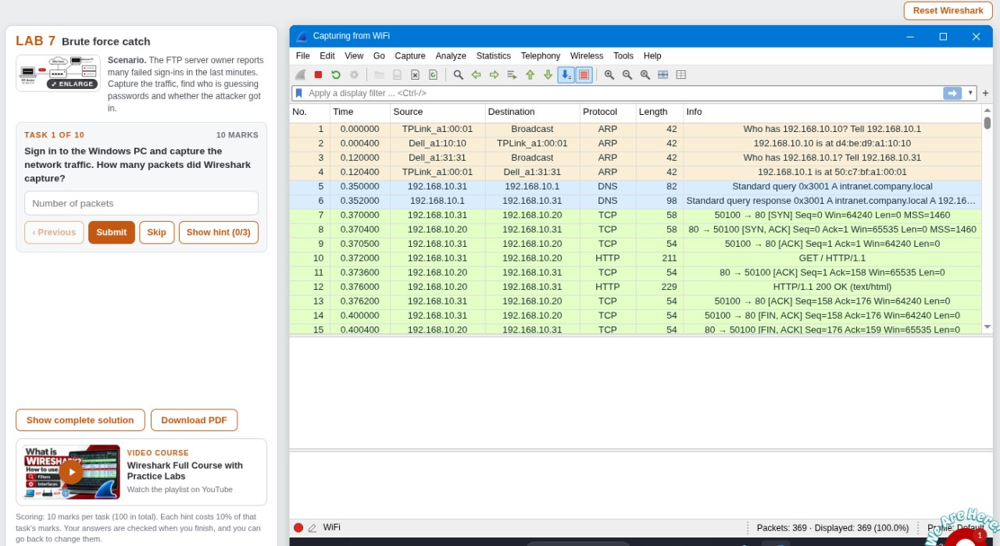
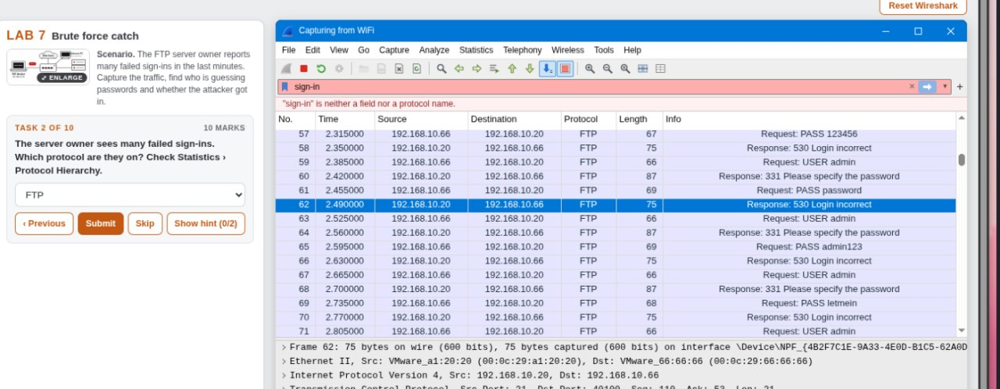
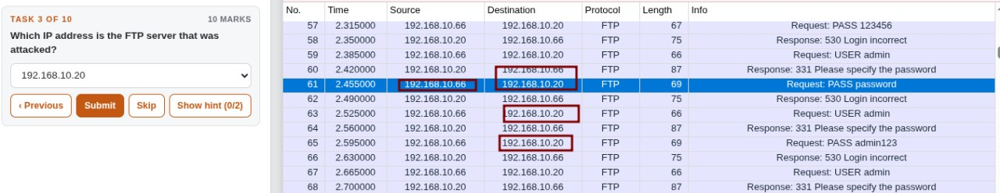
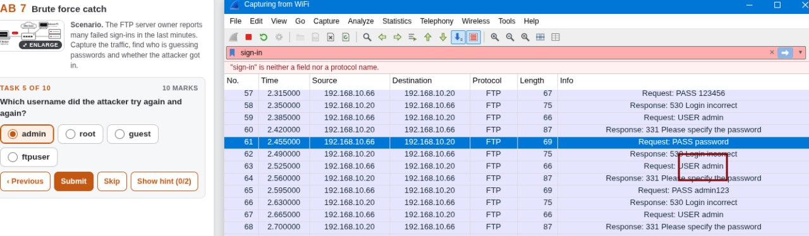
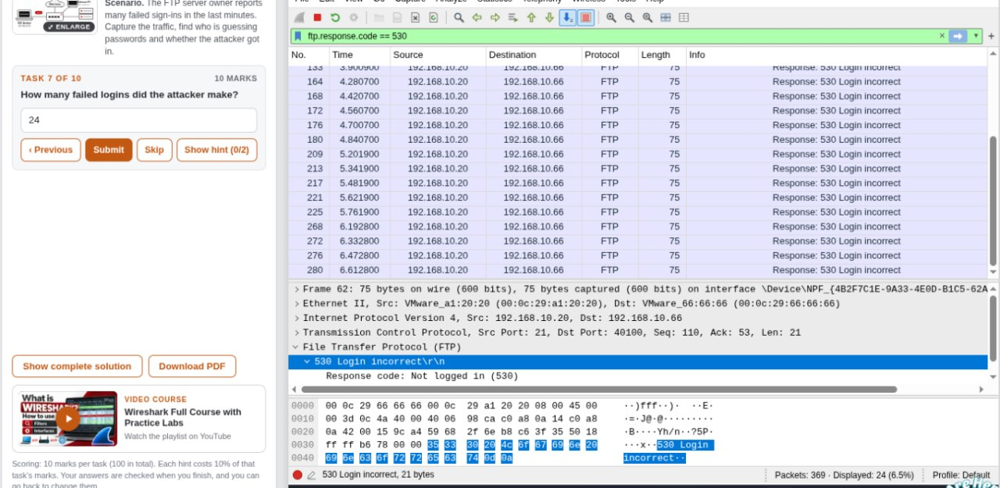

# Lab 7 – Detecting Brute-Force Activity

## Overview

This lab focused on analyzing network traffic in Wireshark to identify FTP login attempts and detect brute-force activity.

## Objectives

- Analyze FTP network traffic.
- Identify failed login attempts.
- Investigate repeated password guesses.
- Identify successful login activity.
- Determine the type of attack.

## Tools Used

- Wireshark
- Networkwalks browser-based lab environment

## Tasks and Findings

| Task | Description | Finding |
|---|---|---|
| Failed login investigation | Identify unsuccessful FTP login attempts | Analyzed FTP response codes |
| Task 10 | Identify the attack involving many password guesses against one user followed by a successful login | Brute-force attack |

## Wireshark Filters

**Filter FTP traffic:**

```text
ftp
```

**Display failed FTP login responses:**

```text
ftp.response.code == 530
```

## Analysis

The FTP traffic was examined to identify repeated login attempts and unsuccessful authentication responses.

The investigation demonstrated how repeated password guesses against one user, followed by a successful login, indicate a brute-force attack.

## Conclusion

This lab demonstrated how Wireshark can help identify suspicious FTP authentication activity and recognize brute-force attacks through repeated login attempts.

## Screenshots

### Task 1


### Task 2


### Task 3


### Task 5


### Task 6


### Task 8


### Task 9


### Final Result

