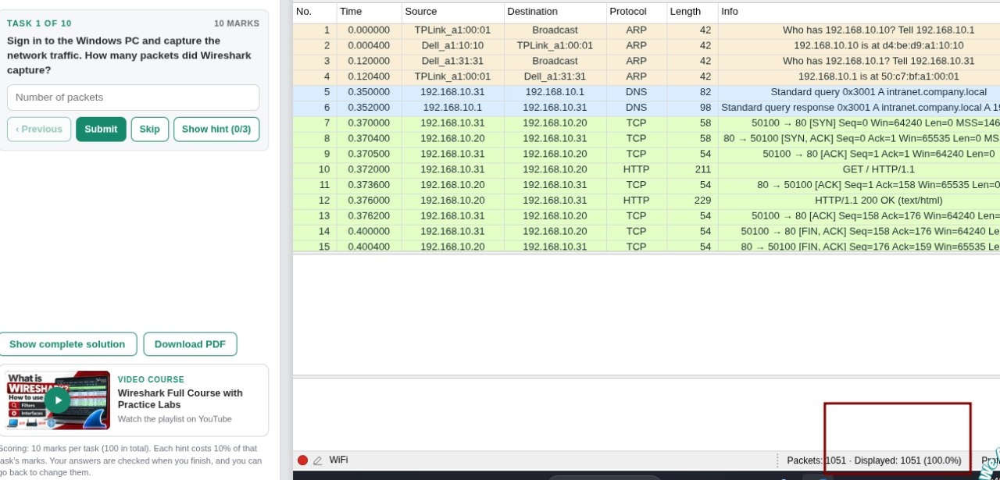
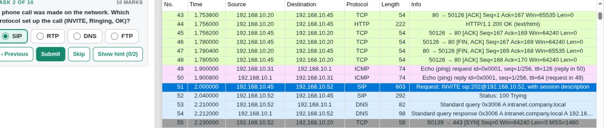
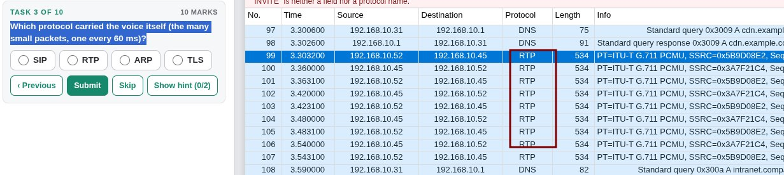
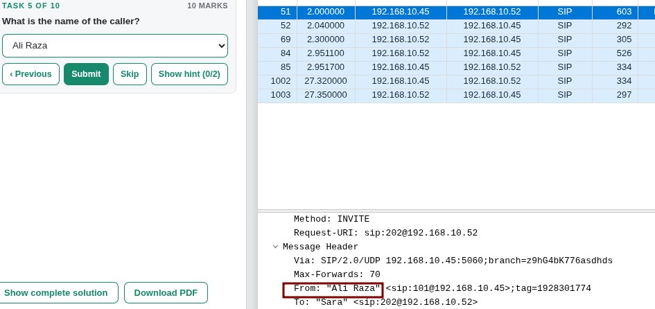
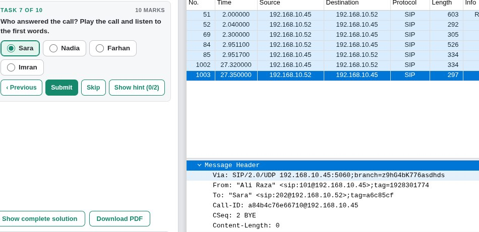
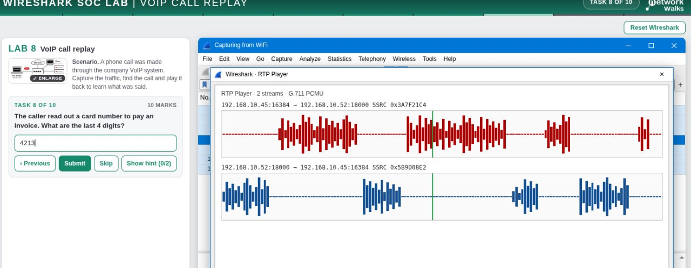
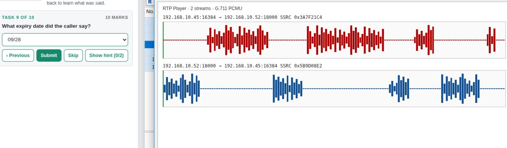

# Lab 8 – Investigating a Suspicious VoIP Call

## Overview

This lab focused on analyzing VoIP network traffic in Wireshark to investigate a suspicious phone call and identify the protocols carrying the voice communication.

## Objectives

- Analyze VoIP network traffic.
- Identify the protocol carrying voice data.
- Investigate RTP packets.
- Examine the suspicious call.
- Identify information shared during the call.
- Recommend a security measure to protect voice communication.

## Tools Used

- Wireshark
- Networkwalks browser-based lab environment

## Tasks and Findings

| Task | Description | Finding |
|---|---|---|
| Voice protocol | Identify the protocol carrying the voice data | RTP (Real-time Transport Protocol) |
| Task 10 | Recommend how to prevent unauthorized people from listening to calls | Encrypt calls using SRTP |

## Analysis

The captured network traffic was examined to identify the protocols involved in the VoIP communication.

RTP was identified as the protocol carrying the voice data in small, regularly transmitted packets.

The suspicious call was also investigated to examine the information shared during the conversation.

## Security Recommendation

The company should encrypt VoIP calls using SRTP (Secure Real-time Transport Protocol).

SRTP protects voice data through encryption, helping prevent unauthorized people from listening to captured call traffic.

## Conclusion

This lab demonstrated how Wireshark can be used to investigate VoIP traffic, identify RTP packets, and understand the importance of encrypting voice communication.

## Screenshots

### Task 1

### Task 2

### Task 3

### Task 4

### Task 5

### Task 6

### Task 7

### Task 8

### Task 9

### Final Result

